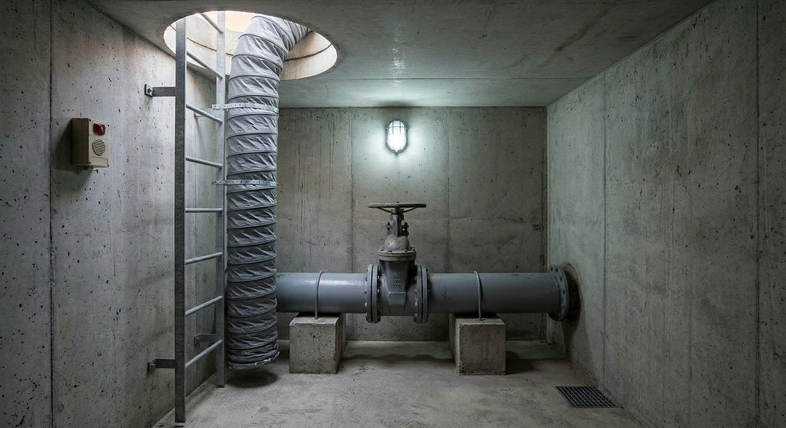
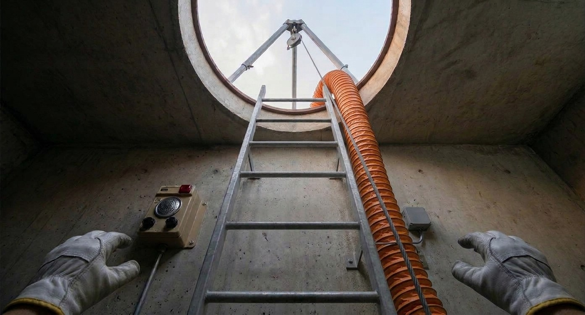

# BlendXR x ApexDream: Confined Space Test Brief

## Required setup

Confirm you have all of this before day 0. If anything is missing or conflicts, email us before you start, not during the build.

| Item | Requirement |
| --- | --- |
| Engine | Unreal Engine 5.7.1, built from Meta's Oculus-VR fork, latest 5.7 tag ([install guide](https://developers.meta.com/vr/documentation/unreal/unreal-quick-start-install-unreal-engine)). Requires a verified Meta developer account, with Epic and GitHub accounts linked. |
| Meta XR plugin | The version bundled with that fork tag. Do not install a second copy. |
| Meta XR Interaction SDK | v203.0, built for UE 5.7.1 ([download](https://developers.meta.com/horizon/downloads/package/meta-xr-interaction-sdk-unreal/203.0/)). If its version check warns about the Meta XR plugin version, stop and email us. |
| Android toolchain | Android SDK, NDK and JDK exactly as Epic specifies for UE 5.7. |
| Headset | Meta Quest 3, developer mode on, hand tracking on |
| Headset OS | Latest public Meta Horizon OS release. Note the exact build number you tested on. |
| Input | Head gaze only. Hand tracking for visible hands. No controllers. |

We install the APK on our own Quest 3 from macOS with SideQuest or Meta Quest Developer Hub, so it must sideload and run with no extra setup. Set a clear app name, app icon and package name so it shows cleanly in the headset library.

## Purpose and test terms

One short Unreal scene, about 25 to 45 seconds, delivered as a demo Quest 3 APK within 7 working days of day 0. BlendXR owns scenario, design and interaction logic. ApexDream owns implementation and the build.

This is professional safety training content: realistic, restrained, no game effects.

We will evaluate four things:

1. **On time.** The APK delivery hits.
2. **Runs in headset.** Sideloads and runs smoothly.
3. **Gaze feels right.** Targets register when looked at: never by accident while scanning, and never needing an overly long look to count as *observed*.
4. **Communication.** Questions asked early, blockers flagged the day they appear.

If time runs short, cut visual detail, not timing or pulse behavior.

**Terms**

- This test is unpaid. Budgets are discussed only if we move to full experiences.
- The scenario, interaction logic and this brief are confidential. Do not share, reuse or show them, including in your portfolio, without written permission. The agreement you signed to open this page covers everything in it.
- All work produced for this test belongs to BlendXR.

## Scene concept: Valve Chamber, Air Turning Bad

The trainee stands at a gate valve inside an underground concrete valve chamber, reached by a fixed ladder from a manhole above. Fresh air is blowing down a ventilation duct from the surface. Then the blower cuts out and winds down to silence. Soon after, the gas detector beside the ladder starts flashing. The trainee recognizes the warning signs and turns to the ladder, their way out. If they ignore the warnings, the detector's alarm sounds and the scene ends.

No text, no arrows, no menus, no score shown. The trainee is never told where to look. Cues exist to build awareness and raise alerts, not anxiety.

**Chamber layout**

| Element | Spec |
| --- | --- |
| Chamber | Cast concrete box, about 3.0 m x 3.0 m floor, about 3.0 m from floor to the underside of the roof slab. Dry concrete with dust and old water stains. A small sump grate in one corner. |
| Player start | About 1.4 m from the front wall, centered side to side, facing the valve. About 1.5 m clear to the side and back walls, so outstretched arms never reach a wall. |
| Valve (task) | One pipe, about 300 mm diameter, runs wall to wall about 0.8 m from the front wall, its center about 0.5 m above the floor on two concrete plinths. Gate valve in the middle of the run, directly in front of the player, with its handwheel on top: about 0.45 m across, about 1.0 m above the floor (waist height), about 0.6 m from the player. |
| Ladder | Galvanized steel fixed ladder bolted to the left wall, rising to the manhole. About 90 degrees to the player's left. Rungs about 300 mm apart, about 180 mm off the wall. |
| Manhole | Round opening about 750 mm wide in the roof slab above the ladder. Pale early-morning daylight above. |
| Tripod | Metal rescue tripod standing over the manhole. Its winch line runs down beside the ladder toward the player and out of view, as if clipped to the trainee's harness. Seen from below against the sky. |
| Ventilation duct | Flexible duct, about 300 mm diameter, coming down through the manhole beside the ladder's right rail, strapped to the rail, outlet just above the floor beside the left plinth. Flutters slightly while air flows. |
| Gas detector | Fixed on the left wall beside the ladder at head height, about 1.6 m up. Red lens unlit until it starts flashing at 19.8 s. A conduit runs from it up to the roof slab. |
| Light | One caged bulkhead light, cool white, on the front wall above the valve, about 2.2 m up. |
| Dressing | None beyond the above. Fewer props, better made. |

Build everything at real-world scale and check it in headset: the handwheel should sit at your own waist height, and the walls should feel close but out of reach.

The daylight through the manhole is the only warm, bright point in the scene, so the way out always reads clearly.

**Reference images** (AI-generated, for mood and layout only. Duct color varies: use the supplied duct as it comes.)

## Flow

Times are from the moment the chamber is fully faded in.

| Phase | Time | What happens |
| --- | --- | --- |
| Enter | Before 0:00 | App opens to black and S3 plays. Recenter so the player faces the valve. 2 s fade into the chamber. S1 hum and S2 air already playing, duct fluttering. |
| Settle | 0 to 9.8 s | Routine. Air flowing, nothing changes and nothing pulses. |
| Recognize | 9.8 s | The blower cuts out: S2 plays its clunk and wind-down, and the duct's flutter eases with the sound. |
|  | 13.3 s | S2 ends and the duct goes still. DUCT unlocks. |
|  | 16.1 s | Duct notice pulse, only if the duct has not been observed yet. |
|  | 19.8 s | The detector's red lens starts flashing, silently. |
|  | 22.6 s | Detector notice pulse, only if the detector has not been observed yet. |
| Respond | Detector observed | LADDER unlocks. |
|  | Detector observed + 2.8 s | Ladder notice pulse, only if the ladder has not been observed yet. |
| Exit | Ladder observed | 2 s fade to black, then the app quits. No alarm. |
| Exit (ignored) | Active target still not observed 5.8 s after its notice pulses end | S4 alarm plays once, 2 s fade to black, then the app quits. |

Pacing: about 25 s for a fast trainee. If warnings are ignored, the alarm ends the scene by about 43 s at the latest.

## Gaze targets and cues

**Input is head gaze.** Quest 3 has no eye-tracking hardware, so the ray comes from the center of the headset view. Build it so true eye tracking can replace the ray source later without touching the targets.

- Use Meta XR Interaction SDK gaze: enable gaze in project settings and add the gaze rig component to the pawn.
- If that blocks you, a sphere trace from the HMD camera each tick is acceptable (radius 5 cm, range 6 m, dedicated `Gaze` trace channel). Email us which you used.
- No visible reticle in the shipping build. A debug reticle behind a console toggle is welcome.

**Targets**

| ID | Target | Role | Pulses | Gaze volume |
| --- | --- | --- | --- | --- |
| DUCT | Ventilation duct | Recognize | Notice only | Full duct length |
| DETECTOR | Gas detector by the ladder | Recognize | Yes | Detector mesh plus a small margin |
| LADDER | Fixed ladder and manhole | Respond | Yes | Full ladder up to and including the manhole ring |

One reusable component, `BP_GazeTarget`, drives all three. Each carries a `Role` field (Recognize, Respond).

Target rules in detail (unlock, pulse timings, dwell thresholds, alarm, pulse look)

**Rules for pulsed targets**

1. **Unlock.** DUCT unlocks when S2 ends (13.3 s). DETECTOR unlocks when the air stops (9.8 s), so checking it before the lens flashes still counts. LADDER unlocks the moment DETECTOR is observed.
2. **Hold.** No pulse until 2.8 s after unlock. DETECTOR is the exception: 2.8 s after the lens starts flashing (22.6 s). If observed before then, the target never pulses.
3. **Notice.** At the pulse time, play exactly 2 notice pulses at 0.8x speed (1.5 s per pulse, 3 s total). If observed during them, fade out over 0.3 s.
4. **Alert.** DETECTOR and LADDER only: if still not observed after both notice pulses, fade in the alert pulse at 2.8x speed (about 0.43 s per pulse), looping until observed. Then fade out over 0.3 s. DUCT has no alert pulse: after its notice pulses it stays still.
5. **Observed.** Continuous dwell reaches the target's threshold while it is unlocked. Gaps under 0.25 s do not reset dwell. Looks before a target unlocks do not count as observed.
6. **Alarm.** The active target is DETECTOR until it is observed, then LADDER. If the active target is still not observed 5.8 s after its notice pulses end, S4 plays once, then a 2 s fade to black and the app quits. A trainee who observes the detector and then the ladder never hears the alarm.

**Dwell thresholds**

- Tunable from 1.2 to 1.8 s per target. Defaults: DUCT 1.5 s, DETECTOR 1.5 s, LADDER 1.5 s.
- Every timing and threshold on this page is a variable on the component or a data asset, never hardcoded.

**Pulse look**

Reference from our police sim (the pulsing toolbox), shown on this page. Ignore its text panel: there is no UI here.

<video src="media/highlight-pulse-ref.mp4" controls muted playsinline></video>

- Overlay material: unlit, additive, fresnel edge glow on the target's mesh (duct, detector, ladder rails). No post-process outline.
- Color #ebfcf7. Base cycle 1.2 s at 1.0x speed. Subtle peak: it should read as the object catching light, not a game pickup.

## Interaction, hands and movement

- **Interaction is gaze only.** Looking at the ladder ends the scene. Ignoring the warnings ends it with the alarm. Nothing is grabbed, pressed or pinched.
- **Hands.** Tracked hands (Quest hand tracking) with the gloves material we supply, for presence only. No controllers.
- **Standing, real height.** The trainee stands. Set the tracking origin to floor level so the trainee's real height sets their eye height and the chamber floor sits on their real floor. Recenter resets position and facing only, never height. No seated mode and no height offset.
- **Movement.** Restricted. No locomotion, teleport or snap turn. The player can turn and lean physically. Clamp the player to about a 0.4 m radius around the start point so they cannot walk into the valve or toward the walls; fade to black briefly if they push past it. The clamp replaces collision setup, so no collisions are needed.

## Visual and audio direction

**Look.** A working utility valve chamber, not a dungeon. Dry cast concrete with real wear, dust and old water stains. Fewer props, better made.

**Light.** ApexDream sets this up. One cool white bulkhead light above the valve, slightly underexposed. Pale daylight through the manhole as the only warm contrast. Baked lighting. The detector's red lens is an emissive material that flashes from 19.8 s until the app quits.

Window, duct and audio detail

**Window above the manhole.** A simple HDRI or skybox plane with an early-dawn sky and a soft industrial silhouette. It only needs to read as outside and morning.

**Duct.** A subtle flutter while air flows (a material world position offset is enough), easing out with the S2 wind-down and fully still the moment S2 ends.

**No fog, smoke or visible gas.** The hazard is invisible. The trainee only knows from the duct and the detector.

**Audio (4 sounds, supplied)**

| ID | Sound | Behavior |
| --- | --- | --- |
| S1 | `hum-electric.mp3` | Low room tone. Loop from the fade-in. Non-spatial or very wide. |
| S2 | `fan-off.m4a` | Spatialized at the duct outlet. Starts at 0:00 and plays once. The file is cut to the scene: running, clunk at 9.8 s, wind-down to silence. No looping or trimming needed. |
| S3 | `EnterApp.mp3` | Plays once over the black screen at app start, leading into the fade-in. Non-spatial. |
| S4 | `carbon-monoxide-detector.m4a` | Spatialized at the detector. Plays once, only on the ignored-warnings exit, and carries through the 2 s fade. |

No other sounds. The trainee should be able to turn toward the duct by ear alone.

## Assets

**Supplied by BlendXR** (from BlendXR's Fab account, see below)

| Asset | Use for |
| --- | --- |
| [Hospital Generator & Utility Room](https://www.fab.com/listings/738ef059-522b-4909-b9c5-52a280b9eadc) by Red Blue Pixel Studio | Concrete and wall materials, conduit, sump grate, bulkhead light if it fits |
| [Gloves material](https://www.fab.com/listings/58794730-2855-4361-8f89-6af80d947f13) | VR hands |
| [Flexible Duct Tubes](https://www.fab.com/listings/bbbe87e9-8857-42d7-9982-ad8a59d61eba) by PropHaus | Ventilation duct (DUCT). Use SM_DuctTube_4m_Var_01 or two SM_DuctTube_2m_Low, not the 6 m mesh. |
| [Detector Beep](https://www.fab.com/listings/71564afb-8af3-4c75-bffa-b0f726662b4d) | Gas detector (DETECTOR). Use the mesh only: ignore its detection Blueprint and sounds. Mount it on a simple wall bracket and make the red lens emissive. |
| [Metal Ladder](https://www.fab.com/listings/9bc28fe9-13df-4c19-bc1e-ad8b6ff402bd) (Quixel Megascans) | Fixed ladder (LADDER). Scale to the chamber height and widen to about 41 cm. |
| [Warehouse](https://www.fab.com/listings/a3149fab-3906-4043-b6ee-3937b752a06c) (Quixel Megascans) | Electrical boxes, conduit, cable and lamp dressing. |
| S1, S2, S3, S4 sound files (download below) | Audio |
| Highlight pulse reference | Video above |

Download the Fab items above from BlendXR's Fab account. airem@blendxr.online will send the login separately and handle sign-in codes during reply windows. Sign in, add them to your project, sign out, and email us when it's done. The password will be changed after that. Use the account only for these items: no other downloads, purchases or setting changes. Use them only for this project, do not share them further, and delete them when the test ends.

**Build in Unreal**

- Chamber shell: walls, floor and roof slab with the manhole opening.
- Manhole ring.
- Rescue tripod and winch line, from simple cube bars.
- Gate valve with handwheel, pipe and plinths.
- Greybox is fine for any of the above.

For anything else, greybox it or use free Fab or Megascans assets.

Tick the day 0 confirmation at the bottom of this page by Thursday, November 19 (IST). The delivery clock starts the day you tick it.

<!-- DOWNLOADS PANEL: rendered here by the page (see page-spec.md) -->

## Deliverables and timeline

| Day | Date (IST) | Checkpoint | What we receive |
| --- | --- | --- | --- |
| Day 0 | By Thu, Nov 19 | Start | Day 0 confirmation: you can access every asset and the setup works |
| Delivery | Day 0 + 7 working days | Demo APK | Full flow from fade-in to app quit with all three gaze targets, pulses, timings and both exits |

Upload the APK through the upload panel at the bottom of this page. No Drive links or email attachments.

## Communication

Your key contact for the test is **airem@blendxr.online**. All test communication goes there, from day 0 to final delivery. No other channels during the test.

**Reply windows** (daily). Questions sent outside a window are answered in the next one.

| India (IST) | Pacific (PST) |
| --- | --- |
| 9:30 to 11:30 am | 8:00 to 10:00 pm, previous day |
| 9:30 to 11:30 pm | 8:00 to 10:00 am |

- Ask as many questions as you need. A short question on day 2 beats a wrong assumption on day 12.
- Flag blockers the day they appear.
- Any scope change, including dropping an interaction, is agreed by email before you build it.

<!-- UPLOADS PANEL: rendered here by the page (see page-spec.md) -->

## Sources

- [Installing Unreal Engine for Meta Quest (Meta)](https://developers.meta.com/vr/documentation/unreal/unreal-quick-start-install-unreal-engine)
- [Meta XR Interaction SDK for Unreal v203.0 (Meta)](https://developers.meta.com/horizon/downloads/package/meta-xr-interaction-sdk-unreal/203.0/)
