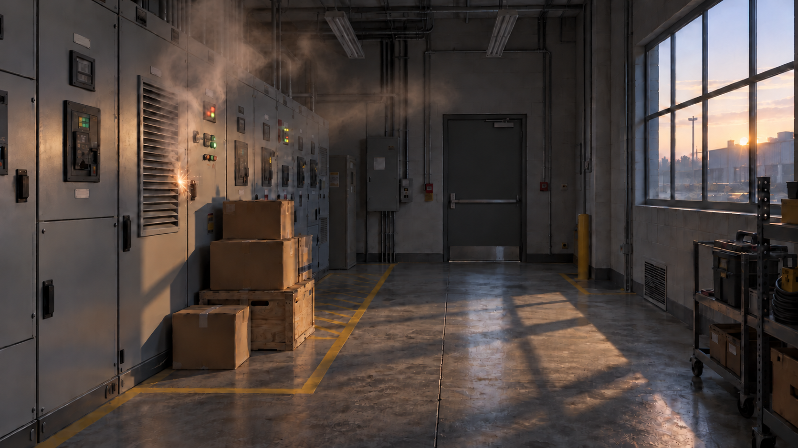
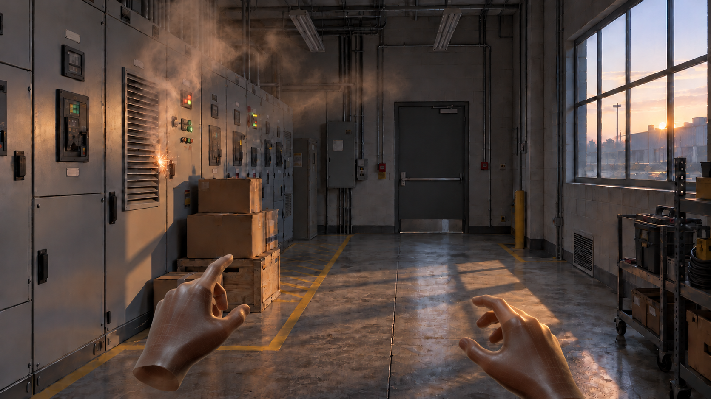

# BlendXR x Volga — Test Scene Brief

## Required setup

Confirm you have all of this before day 0. If anything is missing or conflicts, email us before you start, not during the build.

| Item | Requirement |
| --- | --- |
| Engine | Unreal Engine 5.7.1, built from Meta's Oculus-VR fork, latest 5.7 tag ([install guide](https://developers.meta.com/vr/documentation/unreal/unreal-quick-start-install-unreal-engine)). Requires a verified Meta developer account, with Epic and GitHub accounts linked. |
| Meta XR plugin | The version bundled with that fork tag. Do not install a second copy. |
| Meta XR Interaction SDK | v203.0, built for UE 5.7.1 ([download](https://developers.meta.com/horizon/downloads/package/meta-xr-interaction-sdk-unreal/203.0/)). If its version check warns about the Meta XR plugin version, stop and email us. |
| Android toolchain | Android SDK, NDK and JDK exactly as Epic specifies for UE 5.7. |
| Headset | Meta Quest 3, developer mode on, hand tracking on |
| Headset OS | Latest public Meta Horizon OS release. Note the exact build number you tested on. |
| Input | Hand tracking only. No controllers needed. |
| Version control | Git with Git LFS from day 1, delivered as a zip with full history (see Deliverables) |

We install the APK on our own Quest 3 from macOS with SideQuest or Meta Quest Developer Hub, so it must sideload and run with no extra setup. Set a clear app name, app icon and package name so it shows cleanly in the headset library.

## Purpose and test terms

One short Unreal scene, 12 to 22 seconds, delivered as an optimized Quest 3 APK and a clean project within 14 days. This is shorter than the 1 to 2 minutes first discussed; the scope below replaces it. BlendXR owns scenario, design and interaction logic. Volga owns technical art, implementation and an optimized build.

We will evaluate five things:

1. **On time.** Both check-ins and the final delivery hit.
2. **Runs clean in headset.** Sideloads, holds frame rate, no hitches on load, alarm or exit fade.
3. **Gaze feels right.** Target assets register when looked at: never by accident while scanning, and never needing an overly long look to count as *observed*.
4. **Project quality.** Someone outside your team can open, understand, modify and rebuild it quickly.
5. **Communication.** Questions asked early, blockers flagged the day they appear.

If time runs short, cut visual detail, not frame rate, project hygiene or sequence.

**Terms**

- This test is unpaid. Budgets are discussed only if we move to full experiences.
- The scenario, interaction logic and this brief are confidential. Do not share, reuse or show them, including in your portfolio, without written permission. The test agreement you signed to open this page covers everything in it.
- All work produced for this test belongs to BlendXR.

## Scene concept — Electrical Room, Before the Fire

The trainee stands in a switchgear room at dawn. Nothing happens at first. Then a panel starts to fail: smoke at a vent, a spark, and boxes stacked against the panel. The scene highlights the smoke so the trainee notices it; the fire alarm pull station on the far wall then highlights so they can trigger the alarm. The spark and the stacked boxes stay in view the whole time — gaze on them is logged for scoring but never prompted. Pulling the alarm ends the scenario and the app loops straight back to the Enter phase for the next viewer.

No text, no arrows, no menus, no score shown. Cues exist to build awareness and raise alerts, not anxiety.

**Room layout**

| Element | Spec |
| --- | --- |
| Room | About 10 m long x 5 m wide x 4 m high |
| Player start | About 1.5 m from the near wall, slightly left of center, facing down the room toward the far wall |
| Panel run | About 10 floor-standing switchgear panels along the left wall, P1 nearest the player. Meters, indicator lights, rotary handles. Label plates stay blank. |
| Faulty panel | P3, the panel with the large louvered vent. Smoke rises from the top of the vent and drifts toward the ceiling. Sparks at the right edge of the vent, beside the handle. |
| Boxes | 3 cardboard boxes on a low wooden crate, stacked against P3 and P4, inside a yellow hatched keep-clear floor zone (paint only, no lettering) |
| Far wall | Wall-mounted electrical box on the left, a tall grey cabinet in the left corner, a fire alarm pull station centered at chest height (red faceplate, visible lever), exposed conduit. |
| Right wall | Large steel-framed window, about 4 m wide x 3 m high, sill at about 1.2 m. Low dawn sun over an industrial yard. Floor vent grille below it, yellow bollard near the near-wall corner, a rolling tool cart and shelving near the player. |
| Ceiling | 2 to 3 suspended fluorescent fixtures, exposed conduit and pipes |

The window is on the right and in view from the start, so the room never feels sealed. Dawn light across the floor is the only warm tone.

**Reference images** (AI-generated, for mood and layout only)





## Flow

One level, three phases. Times are from the moment the room is fully faded in.

| Phase | Time | What happens | Pulses |
| --- | --- | --- | --- |
| Enter | Before 0:00 | App opens to black and S3 plays. Recenter so the player faces down the room. 2 s fade into the room. Room hum (S1) already playing. | None |
| 1. Settle | 0:00 to 5.8 s | Still room. Nothing changes, nothing to find. Dawn light from the window on the right. Dwell is logged on every target throughout. | None |
| 2. Observe | From 5.8 s | Smoke starts at P3's vent and is clearly evident by 7.8 s. Sparks and crackle (S2) begin at P3. `smoke` pulses with notice / alert until observed. `spark` and `boxes` are visible but silent — gaze on them is logged, never prompted. | Notice, then alert if needed |
| 3. Act | After `smoke` is observed | The fire alarm pull station on the far wall unlocks with the same pulse logic. Dwell on it fires S4 and starts the exit fade immediately. | Notice, then alert if needed |
| Exit | Alarm observed | 2 s fade to black with S4. The app then returns to the Enter phase with a fresh `session_id` so a reviewer can hand the headset to the next viewer without relaunching. The headset system menu (Oculus button) quits the app. | None |

Pacing: under 12 s for a fast trainee, about 22 s well paced, longer is fine. Nothing times out. The fade-to-black / Enter loop lets a reviewer run back-to-back private demos under half a minute each.

## Target logic

Input is head gaze. Quest 3 has no eye-tracking hardware, so the ray comes from the center of the headset view. Four gaze targets, two kinds:

| ID | Target | Kind | Role | Gaze volume |
| --- | --- | --- | --- | --- |
| `smoke` | Smoke at P3's vent | Pulsed | Observation | Box around the upper vent and lower plume |
| `alarm` | Fire alarm pull station on the far wall | Pulsed | Interaction | Box around the pull station lever and faceplate |
| `spark` | Spark at the right edge of P3's vent | Logged | Observation | Small box around the spark point, separate from `smoke` |
| `boxes` | Cardboard boxes in the keep-clear zone | Logged | Observation | Box stack meshes |

**Pulsed** targets drive the scene: `smoke` unlocks at 5.8 s; `alarm` unlocks the moment `smoke` is observed; observing `alarm` fires the exit. Each pulsed target cycles through grace → notice pulse → alert pulse until observed. **Logged** targets are visible from fade-in and never pulse; their only job is to record where the trainee looked without prompting. All four write the same `BP_GazeTarget` events so the dashboard treats them uniformly.

<details>
<summary>Target rules in detail (SDK, pulse timings, dwell thresholds, pulse look)</summary>

**Gaze input**

- Use Meta XR Interaction SDK gaze: enable gaze in project settings and add the gaze rig component to the pawn.
- If that blocks you, a sphere trace from the HMD camera each tick is acceptable (radius 5 cm, range 6 m, dedicated `Gaze` trace channel). Email us which you used.
- No visible reticle in the shipping build. A debug reticle behind a console toggle is welcome.

**Rules per pulsed target**

1. **Unlock.** `smoke` unlocks at 5.8 s with the smoke appearance. `alarm` unlocks the moment `smoke` is observed.
2. **Grace.** For 2 s after unlock, no pulse. If the target is observed in that window, skip its pulses and continue (unlock the next pulsed target, or fire the exit if this is `alarm`).
3. **Notice.** If not yet observed after 2 s, play exactly 2 notice pulses at 0.8x speed (1.5 s per pulse, 3 s total). If observed during them, fade out over 0.3 s and continue.
4. **Alert.** If still not observed after both notice pulses finish, fade in the alert pulse: 2.8x speed (about 0.43 s per pulse), looping until observed. Then fade out over 0.3 s and continue.
5. **Observed.** Continuous dwell reaches the target's threshold while it is unlocked. Gaps under 0.25 s do not reset dwell.

**Logged targets**

- `spark` and `boxes` are active from `fade_in_complete`. They never unlock in a turn, never pulse, and never time out.
- `gaze_enter`, `gaze_exit` and dwell on them run the whole session.
- They trigger nothing in the scene; the dashboard scores them as "did the trainee look without being prompted?"

**Dwell**

- Threshold per pulsed target, tunable from 1.2 to 1.8 s. Defaults: `smoke` 1.5 s, `alarm` 1.8 s.
- Dwell is tracked on every target the whole session. For pulsed targets, only dwell inside the unlocked turn counts as *observed*.
- Every number on this page is a variable on the component or a data asset, never hardcoded.

**Pulse look**

Reference from our police sim (the pulsing toolbox). Ignore its text panel: there is no UI here.

<video src="media/highlight-pulse-ref.mp4" controls muted playsinline></video>

- Overlay material: unlit, additive, fresnel edge glow on the target's mesh (vent grille for `smoke`, pull station faceplate and lever for `alarm`). No post-process outline.
- Color #ebfcf7. Base cycle 1.2 s at 1.0x speed. Subtle peak: it should read as the object catching light, not a game pickup.
- Logged targets never show this overlay.

</details>

## Session data

The scene writes a JSON file per session to the app's storage on the headset so BlendXR's dashboard can score and compare runs. No network calls in this test. A fresh `session_id` is minted every time the room fades back in, so back-to-back private demos stay as separate files.

Build the logger as one component (`BP_SessionLogger`). Per session it records: target IDs, when each pulsed target unlocked, first-gaze time, dwell duration (total and in-turn), observed time, which pulse level fired, and total scenario time. Field names and types are frozen in the schema below so the Unreal build and the BlendXR dashboard converge on the same contract.

<details>
<summary>Full session-file schema (field names, event list, sample file)</summary>

**Session header**

| Field | Type | Notes |
| --- | --- | --- |
| `session_id` | UUIDv4 string | Fresh per run (new one after the restart loop fades the room back in). |
| `scenario` | string | `"electrical-room-v2"`. Freezes with the brief; bump the suffix when the brief does. |
| `build_version` | string | Semver from the project settings. |
| `device_model` | string | From the Meta XR API. |
| `started_at` | ISO-8601 UTC | At `fade_in_complete`. |
| `ended_at` | ISO-8601 UTC | At the restart or quit fade start. |
| `ended_reason` | enum | `"completed"` (alarm triggered the exit, loop restart next), `"quit"` (Oculus-button quit), `"restart"` (reserved for a future manual restart). |
| `total_scenario_time_ms` | int | `ended_at` minus `started_at`. |
| `phases` | object | Per-phase start times in ms from `fade_in_complete`. See example below. |

**Phase timestamps (object `phases`):** `fade_in_complete_ms` (always `0`), `observe_start_ms` (= 5800), `act_start_ms` (the moment `smoke` is observed), `exit_fade_start_ms` (the moment `alarm` is observed), `restart_or_quit_ms` (`exit_fade_start_ms` + 2000; the session file is flushed at this moment).

**Per-target summary** (one object per target in the `targets` array; order matches the Target logic table so the dashboard can bar-chart them without a join):

| Field | Type | Notes |
| --- | --- | --- |
| `id` | string | `"smoke"`, `"alarm"`, `"spark"`, `"boxes"`. |
| `kind` | enum | `"pulsed"` or `"logged"`. |
| `role` | enum | `"Observation"` or `"Interaction"`. |
| `unlocked_at_ms` | int or `null` | When the pulsed target's turn begins. `null` for logged targets. |
| `first_gaze_at_ms` | int or `null` | First `gaze_enter` on this target, regardless of lock state. `null` if never gazed. |
| `first_gaze_in_turn_ms` | int or `null` | First `gaze_enter` on or after `unlocked_at_ms`. `null` for logged targets and for pulsed targets never gazed during their turn. |
| `observed_at_ms` | int or `null` | When dwell crossed the pulsed target's threshold during its turn. `null` for logged targets; `null` for pulsed targets whose alert pulse never resolved. |
| `dwell_total_ms` | int | Sum of dwell on this target across the whole session. The scoring metric for logged targets. |
| `dwell_in_turn_ms` | int or `null` | Dwell on this target only during its unlocked turn. The scoring metric for pulsed targets. `null` for logged targets. |
| `gaze_gaps_in_turn` | int or `null` | Count of `gaze_exit` events during the pulsed target's turn before `observed_at_ms` (the 0.25 s gap tolerance does not increment this). `null` for logged targets. |
| `max_gap_ms_in_turn` | int or `null` | Longest gaze gap during the pulsed target's turn before `observed_at_ms`. `null` for logged targets. |
| `pulses_shown` | enum or `null` | `"none"`, `"notice"`, `"alert"`. The strongest cue that fired. `null` for logged targets. |

**Events to log** (array `events`, ordered by `t_ms`, time in ms from `fade_in_complete`):

| Event | Fields |
| --- | --- |
| `fade_in_complete` | — |
| `observe_phase_start` | — |
| `act_phase_start` | — |
| `unlocked` | `target` |
| `gaze_enter` | `target` |
| `gaze_exit` | `target` (after the 0.25 s gap tolerance) |
| `pulse_notice_start` | `target` |
| `pulse_alert_start` | `target` |
| `observed` | `target` |
| `exit_fade_start` | — |
| `session_end` | `reason` ∈ {`completed`, `quit`, `restart`} |

<details>
<summary>Sample session file (abbreviated JSON)</summary>

```json
{
  "session_id": "7b3b4f6a-5b10-4a1f-8c92-98e7cae0f9ad",
  "scenario": "electrical-room-v2",
  "build_version": "0.9.0",
  "device_model": "Quest 3",
  "started_at": "2026-11-14T08:30:00.000Z",
  "ended_at":   "2026-11-14T08:30:14.120Z",
  "ended_reason": "completed",
  "total_scenario_time_ms": 14120,
  "phases": {
    "fade_in_complete_ms": 0,
    "observe_start_ms": 5800,
    "act_start_ms": 8120,
    "exit_fade_start_ms": 12120,
    "restart_or_quit_ms": 14120
  },
  "targets": [
    { "id": "smoke", "kind": "pulsed", "role": "Observation",  "unlocked_at_ms": 5800,  "first_gaze_at_ms": 6230, "first_gaze_in_turn_ms": 6230, "observed_at_ms": 8120,  "dwell_total_ms": 1500, "dwell_in_turn_ms": 1500, "gaze_gaps_in_turn": 0, "max_gap_ms_in_turn": 0,   "pulses_shown": "none"   },
    { "id": "alarm", "kind": "pulsed", "role": "Interaction",  "unlocked_at_ms": 8120,  "first_gaze_at_ms": 8540, "first_gaze_in_turn_ms": 8540, "observed_at_ms": 12120, "dwell_total_ms": 1800, "dwell_in_turn_ms": 1800, "gaze_gaps_in_turn": 1, "max_gap_ms_in_turn": 180, "pulses_shown": "notice" },
    { "id": "spark", "kind": "logged", "role": "Observation",  "unlocked_at_ms": null,  "first_gaze_at_ms": 3100, "first_gaze_in_turn_ms": null, "observed_at_ms": null,  "dwell_total_ms": 420,  "dwell_in_turn_ms": null, "gaze_gaps_in_turn": null, "max_gap_ms_in_turn": null, "pulses_shown": null },
    { "id": "boxes", "kind": "logged", "role": "Observation",  "unlocked_at_ms": null,  "first_gaze_at_ms": null, "first_gaze_in_turn_ms": null, "observed_at_ms": null,  "dwell_total_ms": 0,    "dwell_in_turn_ms": null, "gaze_gaps_in_turn": null, "max_gap_ms_in_turn": null, "pulses_shown": null }
  ],
  "events": [
    { "t_ms": 0,     "kind": "fade_in_complete" },
    { "t_ms": 3100,  "kind": "gaze_enter", "target": "spark" },
    { "t_ms": 3520,  "kind": "gaze_exit",  "target": "spark" },
    { "t_ms": 5800,  "kind": "observe_phase_start" },
    { "t_ms": 5800,  "kind": "unlocked", "target": "smoke" },
    { "t_ms": 6230,  "kind": "gaze_enter", "target": "smoke" },
    { "t_ms": 8120,  "kind": "observed",  "target": "smoke" },
    { "t_ms": 8120,  "kind": "act_phase_start" },
    { "t_ms": 8120,  "kind": "unlocked", "target": "alarm" },
    "…",
    { "t_ms": 12120, "kind": "exit_fade_start" },
    { "t_ms": 14120, "kind": "session_end", "reason": "completed" }
  ]
}
```

</details>

Rules the logger must follow so dashboards from different builds stay comparable:

- Keep every field name and enum value exactly as above. If a field is unknown, write `null`, never omit it.
- Write the file atomically (temp file + rename) at the `restart_or_quit_ms` moment so the loop never produces a half-flushed file.
- Also print each event to the output log for debugging.
- Document the file location and format in the README with two sample files: one `"completed"` and one `"quit"`.

</details>

## Interaction, hands and movement

- **Fire alarm.** The fire alarm pull station on the far wall is the exit interaction. When it is observed (gaze dwell meets its threshold), S4 plays and the scene fades to black over 2 s. No arm reach, no grab, no button press — the dwell is the pull. Visually, the lever can tilt down a few degrees as feedback, but that is cosmetic.
- **Hands.** Tracked hands with Quest hand tracking; apply the gloves from Assets for presence. No controllers. Hands are for presence only; nothing is grabbed or pressed.
- **Movement.** Restricted. No locomotion, teleport or snap turn. The player can turn and lean physically. Clamp the player to about a 1 m radius around the start point so they cannot walk into panels or through walls; fade to black briefly if they push past it. The clamp replaces collision setup, so no collisions are needed.

## Visual and audio direction

**Look.** A real plant room at 6 am, not a showroom. Sealed concrete floor, painted block walls, grey panels with real wear. Fewer props, better made.

**Light.** Volga sets this up. Cool white fluorescent overhead, slightly underexposed. Warm, low dawn light through the window as the only contrast. Baked lighting. One fluorescent above P3 flickers faintly from the start.

<details>
<summary>Window, smoke, spark and audio detail</summary>

**Window.** A simple HDRI or skybox plane with an early-dawn sky and a soft industrial silhouette. It only needs to read as outside and morning.

**Smoke.** One Niagara system at P3's vent: a few soft translucent sprite cards rising slowly. Starts at 5.8 s, reaches full density by 7.8 s, then holds. Thin and grey. Keep particle count and overdraw low. No volumetric fog.

**Spark.** One small Niagara burst at the right edge of P3's vent, every 3 to 5 s from 5.8 s, synced with S2. Brief and small: a real arc, not fireworks.

**Audio (4 sounds, supplied)**

| ID | File | Behavior |
| --- | --- | --- |
| S1 | `hum-electric.mp3` | Room hum. Loop from the fade-in. Non-spatial or very wide. |
| S2 | `crackle.mp3` | Spatialized at P3. Plays with each spark, randomized pitch (plus or minus 10%). |
| S3 | `EnterApp.mp3` | Plays once over the black screen at app start, leading into the fade-in. Non-spatial. |
| S4 | `fire-alarm.mp3` | Spatialized at the fire alarm pull station. Plays when `alarm` is observed and continues through the 2 s fade to black at the restart/quit transition. |

No other sounds. The trainee should be able to turn toward P3 by ear alone.

</details>

## Assets

Three sources: paid packs and our own files, which BlendXR supplies; free Fab listings you download directly; and simple pieces you build in Unreal. For anything else, use free Fab or Quixel Megascans assets and list each one (name, source link, license) in the README.

**Supplied by BlendXR**

| Asset | Use for |
| --- | --- |
| [Hospital Generator & Utility Room](https://www.fab.com/listings/738ef059-522b-4909-b9c5-52a280b9eadc) by Red Blue Pixel Studio (download from BlendXR's Fab account, see below) | Floor and wall materials, cardboard boxes, crates, cables, vents, signs, utility props |
| `hum-electric.mp3` (S1, download below) | Room hum |
| `crackle.mp3` (S2, download below) | Spark crackle |
| `EnterApp.mp3` (S3, download below) | App start |
| `fire-alarm.mp3` (S4, download below) | Alarm pull and the exit fade |
| Highlight pulse reference | Video above |

Download the Hospital Generator & Utility Room pack from BlendXR's Fab account (airem). airem@blendxr.online will send the login separately and handle sign-in codes during reply windows. Sign in, add the pack to your project, sign out, and email us when it is done. The password will be changed after that. Use the account only for that pack: no other downloads, purchases or setting changes. Use the pack only for this project, do not share it further, and delete it when the test ends.

**Free on Fab** (download directly)

| Listing | Use for |
| --- | --- |
| [Gloves material](https://www.fab.com/listings/58794730-2855-4361-8f89-6af80d947f13) | Mesh and material for the tracked hands |
| [Fire Alarm Button](https://www.fab.com/listings/991d908f-d632-4010-921c-2870013be0e4) | Pull station on the far wall. If you have reason to swap for a different pull or push style, email us before you do. |
| [Fire extinguisher](https://www.fab.com/listings/28f9f3a5-6ab9-4de3-8aec-a492b1cce4e4) | Wall-mounted dressing near the alarm (visual only; not interacted with) |
| [Industrial items](https://www.fab.com/listings/060bde6d-33f7-46b8-9c8a-b209d6036d5e) | Panels and industrial dressing |
| [Safety factory pack](https://www.fab.com/listings/bf7f4251-d518-42b9-a2f9-7094016e7ecc) | Safety equipment and signage |
| [Fluorescent ceiling lamp (Megascans)](https://www.fab.com/listings/ed5b0308-d5e5-44ba-b271-af87bedcb547) | Ceiling fixtures |
| [Dawn sky](https://www.fab.com/listings/6d7cdbd3-4d9e-48ba-982a-f4aa07d078e4) | Window exterior |

**Build in Unreal**

- Keep-clear floor markings: simple planes with a flat yellow material. No asset needed.
- The far-wall mount plate and conduit around the alarm, using the packs above where they fit.

This build stays private, so free and non-commercial assets are fine. Day 0 is Wednesday, 11 November 2026. The 14-day clock runs from it, with final delivery on Wednesday, 25 November. Tick the Day 0 confirmation below on 11 November once you have confirmed access to every asset linked here.

<!-- DOWNLOADS PANEL: rendered here by the page (see page-spec.md) -->

## Deliverables and timeline

The project matters as much as the APK. We are testing how you build, solve problems and leave a project others can join.

| Day | Date | Checkpoint | What we receive |
| --- | --- | --- | --- |
| 0 | Wed, 11 Nov | Start | Tick the Day 0 confirmation below on 11 November. Clock starts on tick. |
| 4 | Sun, 15 Nov | Gray box | Headset capture video: room blocked out, gaze working on all 4 targets (`smoke`, `alarm`, `spark`, `boxes`) with the debug reticle on. |
| 9 | Fri, 20 Nov | First APK | Full flow from fade-in through the restart loop, the two pulsed targets working, the two logged targets writing dwell, and the session log export writing to headset storage with the schema in Session data. Placeholder art acceptable. |
| 14 | Wed, 25 Nov | Final | Final APK, zipped project with full Git history, README, two sample session files (one `"completed"`, one `"quit"`) that match the schema in Session data. |

<details>
<summary>Build standards (performance, project hygiene, final delivery format)</summary>

**Performance**

- 72 fps locked minimum on Quest 3, 90 fps if achievable. No drops on fade-in, smoke start, alarm or exit fade.
- Run the Meta XR Project Setup Tool for Quest 3 ([docs](https://developers.meta.com/horizon/documentation/unreal/unreal-project-setup-tool)) and apply all Required and Recommended rules. List any rule you ignored and why.
- Baked lighting, no dynamic shadows, no volumetrics.

**Project standards**

- Git with Git LFS from day 1. Commit as you go: we read the history.
- One root content folder (e.g. `/Content/BlendXR/`), consistent asset naming (`BP_`, `M_`, `MI_`, `T_`, `SM_`, `NS_`).
- Scene logic in reusable Blueprints or C++, not level script. Every timing and threshold exposed.
- No unused or duplicate assets in the final project.
- README: how to open and build, engine and SDK versions, gaze method, Project Setup Tool exceptions, measured frame rate, session file location and format, assets used with sources, known issues.

**Final delivery**

- Upload every checkpoint through the upload panel at the bottom of this page. No Drive links or email attachments. Uploads are versioned, so re-upload rather than replace.
- Final project as one zip of the full repo, including the .git folder and pulled LFS files, that we can open, modify and rebuild with only the README.

</details>

## Communication

Your key contact for the test is **airem@blendxr.online**. All test communication goes there, from day 0 to final delivery. No other channels during the test. Longer-term tools get decided after the test.

**Reply windows** (daily). Questions sent outside a window are answered in the next one.

| Window | Pacific (PST) | India (IST) |
| --- | --- | --- |
| Morning | 8:00 to 10:00 am | 9:30 to 11:30 pm |
| Evening | 8:00 to 10:00 pm | 9:30 to 11:30 am, next day |

- Ask as many questions as you need. A short question on day 2 beats a wrong assumption on day 12.
- Flag blockers the day they appear.
- Any scope change, including dropping an interaction, is agreed by email before you build it.

<!-- UPLOADS PANEL: rendered here by the page (see page-spec.md) -->

## Sources

- [Installing Unreal Engine for Meta Quest (Meta)](https://developers.meta.com/vr/documentation/unreal/unreal-quick-start-install-unreal-engine)
- [Meta XR Interaction SDK for Unreal v203.0 (Meta)](https://developers.meta.com/horizon/downloads/package/meta-xr-interaction-sdk-unreal/203.0/)
- [Unreal Project Setup Tool (Meta)](https://developers.meta.com/horizon/documentation/unreal/unreal-project-setup-tool)
